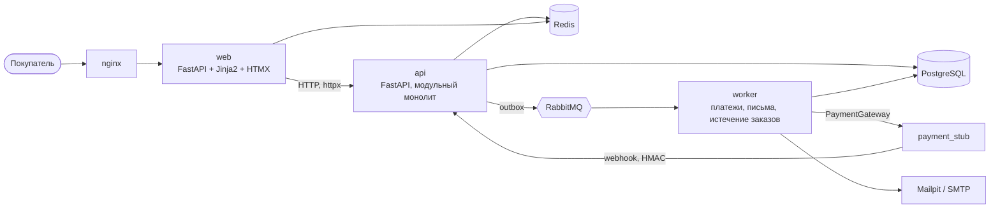

# ForsunkiShop

Интернет-магазин дизельных форсунок со страницей ремонта. Асинхронный бэкенд на Python (FastAPI, PostgreSQL, Redis,
RabbitMQ) с надёжной обработкой заказов, идемпотентными запросами, структурированными логами и воспроизводимой
инфраструктурой на Docker Compose.

## Возможности

- **Каталог:** фильтры по производителю, типу и состоянию, поиск по артикулу (с любыми пробелами и дефисами) и по двигателю,
  курсорная пагинация, картинки товаров, кэш в Redis.
- **Аккаунты:** регистрация и вход (Argon2), короткие JWT и ротируемые refresh-токены, роли покупателя и администратора,
  ограничение частоты запросов.
- **Корзина и заказы:** резервирование остатков без перепродажи, фиксация цен при оформлении, история заказов,
  отмена, идемпотентное оформление (`Idempotency-Key`).
- **Асинхронная обработка:** события через transactional outbox и RabbitMQ с повторами, очередью недоставленных
  сообщений и защитой от дублей.
- **Админка** для управления каталогом.

## Архитектура



| Компонент | Назначение | Состояние |
|---|---|---|
| `api` | бизнес-логика и REST API (модули users, catalog, cart, orders) | работает |
| `worker` | потребители RabbitMQ и relay outbox (тот же образ, что `api`) | работает |
| PostgreSQL, Redis, RabbitMQ, S3-хранилище | данные, кэш и лимиты, очереди, картинки | работают |
| `payment_stub` | заглушка платёжного провайдера | в разработке |
| `web` | сайт (Jinja2 + HTMX) | в разработке |
| nginx, Fluent Bit + Elasticsearch + Kibana, Prometheus + Grafana | вход, логи, метрики | в разработке |

## Быстрый старт

Нужны Linux или WSL2 (Windows), Docker с Compose v2, `make`, `uv`, `git`.

```bash
make secrets   # случайные пароли в deploy/secrets/dev (не коммитятся)
make up        # postgres, redis, rabbitmq, api, worker, S3-хранилище + Adminer, Mailpit
make seed      # заполнить каталог демо-данными (make seed COUNT=20000)
make down
```

| Сервис | Адрес |
|---|---|
| API (Swagger) | http://localhost:8001/docs |
| Админка каталога | http://localhost:8001/admin (вход под пользователем с ролью admin) |
| RabbitMQ UI | http://localhost:15672 (пользователь `forsunki`, пароль в `deploy/secrets/dev/rabbitmq_password`) |
| PostgreSQL | localhost:5433 (порт меняется через `POSTGRES_PUBLISH_PORT` в `.env`) |
| Консоль S3-хранилища | http://localhost:9001 (ключи в `deploy/secrets/dev/s3_*`) |
| Adminer | http://localhost:8080 |
| Mailpit | http://localhost:8025 |

Администратор: `make create-admin EMAIL=you@example.com` (пароль вводится в терминале). Остальные команды: `make help`.

## API

| Метод и путь | Назначение |
|---|---|
| `POST /auth/register`, `/auth/login`, `/auth/refresh`, `/auth/logout` | регистрация, вход, обновление и отзыв токенов |
| `GET /users/me` | текущий пользователь (`Authorization: Bearer ...`) |
| `GET /catalog/injectors` | список: фильтры `manufacturer`, `type`, `condition`, поиск `q`, курсор `cursor`, `limit` до 100 |
| `GET /catalog/injectors/{id}`, `GET /catalog/manufacturers` | карточка с применимостью, список производителей |
| `PUT /catalog/injectors/{id}/image` | загрузка картинки (только admin) |
| `GET /cart`, `PUT /cart/items/{id}`, `DELETE /cart/items/{id}`, `DELETE /cart` | корзина (количество 1-99, не больше остатка) |
| `POST /orders` (`Idempotency-Key`) | оформить заказ из корзины |
| `GET /orders`, `GET /orders/{id}` | история (от новых к старым) и карточка; только свои заказы |
| `POST /orders/{id}/cancel` (`Idempotency-Key`) | отменить неоплаченный заказ |
| `GET /health/live`, `GET /health/ready` | проба процесса и проба зависимостей (БД, Redis, RabbitMQ) |

Ошибки возвращаются в едином формате Problem Details (`application/problem+json`) с `correlation_id`.
Заголовок `X-Cache: HIT|MISS` показывает, откуда пришёл ответ каталога.

## Надёжность

**Заказы.** Оформление выполняется одной транзакцией: резерв остатка условным `UPDATE ... WHERE stock >= n`, заказ
`PENDING_PAYMENT` со снимком цен, очистка корзины, событие `order.created`. Статусы:
`PENDING_PAYMENT → PAID | PAYMENT_FAILED | CANCELLED | EXPIRED` (остальные конечные), недопустимый переход возвращает 409.

| Сценарий | Результат |
|---|---|
| повтор `POST /orders` с тем же ключом | тот же заказ, резерв и событие один раз, заголовок `Idempotent-Replayed: true` |
| 6 одновременных запросов с одним ключом | один заказ |
| 8 покупателей одновременно на последнюю единицу | один заказ (201), семь отказов (409), остаток 0 |
| нехватка одной позиции из нескольких | заказ не создан, остатки всех позиций не тронуты |
| одновременные «отмена» и «истёк» | статус сменил один, товар вернулся один раз |
| случайные последовательности действий (Hypothesis, реальная БД) | остаток + зарезервированное + проданное = начальный запас |
| чужой заказ | 404 |

**Сообщения.**

```
api: транзакция {бизнес-данные + строка outbox}  ->  worker/relay: SELECT ... FOR UPDATE SKIP LOCKED
   -> публикация с confirms (forsunki.events) -> очередь подписчика -> consumer: inbox + обработчик + commit -> ack
        ошибка TemporaryError -> ярус .retry.k (пауза 5/30/120 с) -> снова в очередь
        PermanentError, лимит повторов -> .dlq с причиной в заголовках
```

| Гарантия | Чем обеспечена |
|---|---|
| Событие не теряется, если сохранены данные, и не публикуется, если данные откатились | outbox в одной транзакции с данными |
| Сообщение не теряется, если воркер упал до ack | ручной ack, брокер возвращает сообщение другому воркеру |
| Дубль не даёт двойного эффекта | inbox: запись и эффект в одной транзакции |
| Ядовитое сообщение не зацикливает очередь | лимит повторов, `x-delivery-limit`, DLQ |
| Событие без получателя не блокирует остальные | отложенный повтор с растущей паузой |
| Остановка не теряет сообщения в работе | cancel consumer'ов, ожидание текущих, затем закрытие |

Остановка контейнера (`docker stop`) во время запроса: запрос завершается успешно, остановка занимает секунды.
`/health/ready` отвечает `503`, если недоступна БД, при этом `/health/live` остаётся `200`.

## Производительность

Индексы, `EXPLAIN ANALYZE` на 18 529 форсунках. Поиск редкого артикула (`oem_normalized LIKE '%0414720001%' ORDER BY id LIMIT 21`):

| | План | Время |
|---|---|---|
| без триграммного индекса | `Seq Scan on injectors` (отброшено 18 527 строк) | 7,99 мс |
| с GIN-индексом `gin_trgm_ops` | `Bitmap Index Scan on ix_injectors_oem_normalized_trgm` | 0,47 мс |

Для частого префикса (`%0445110%`, совпадает каждая десятая форсунка) планировщик правильно идёт по первичному ключу и
останавливается после 21 совпадения (0,24 мс): индекс помогает там, где совпадений мало. Поиск по двигателю выполняется за 0,41 мс.

Кэш каталога (`make bench`, 200 запросов на сценарий, мс p50 / p95):

| Сценарий | Без кэша | С кэшем | Ускорение |
|---|---|---|---|
| список, 20 шт. | 9,8 / 11,7 | 3,7 / 4,7 | 2,6x |
| фильтр bosch + new | 9,9 / 11,9 | 4,0 / 5,1 | 2,5x |
| поиск по артикулу | 12,3 / 19,2 | 3,7 / 4,6 | 3,3x |
| поиск по двигателю | 11,8 / 13,3 | 3,8 / 4,7 | 3,1x |
| карточка товара | 7,9 / 9,5 | 3,8 / 5,7 | 2,1x |

Измерено последовательными запросами с той же машины, где работает БД, поэтому разница скромная (около 4 мс любого ответа
уходит на HTTP и сериализацию); под конкурентной нагрузкой выигрыш больше.

## Разработка

```bash
make lint   # ruff + mypy
make test   # unit и интеграционные тесты на настоящих Postgres, Redis, RabbitMQ и S3 (Testcontainers)
make fmt    # ruff format
```

Установите хуки: `pre-commit install` (ruff, проверка секретов gitleaks). Пароли и ключи живут в файлах, а не в переменных
окружения: `make secrets` создаёт их в `deploy/secrets/dev` (в репозиторий не попадают).

Структура репозитория:

```
services/
  api/              бэкенд и воркер (app/core, app/modules, app/worker), миграции Alembic, тесты
  web/              сайт
  payment_stub/     заглушка платёжного провайдера
deploy/             Compose-файлы, шаблоны секретов
scripts/            вспомогательные скрипты (замеры)
```
